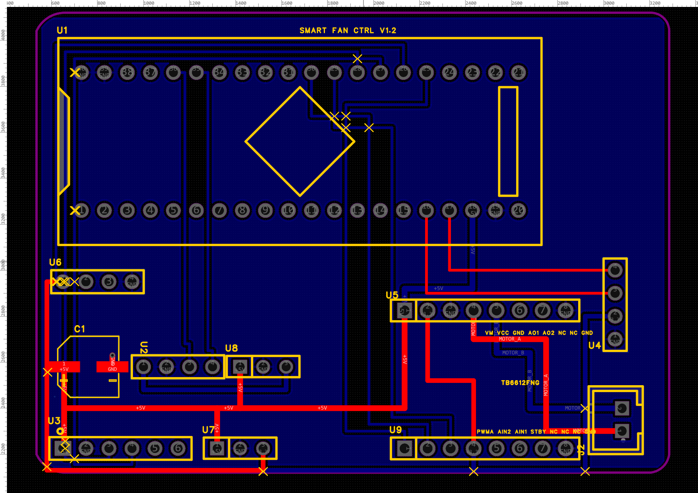

# 智能温控风扇 & 物联网网关 PCB 硬件工程

本目录包含智能温控风扇系统的完整定制 PCB 设计工程源文件、制版说明与排线规范。

---

## 1. 工程文件结构

```
Hardware_PCB/
├── SmartFan_LCEDA_Project.epro2    # 立创EDA专业版原生工程源码包（包含原理图与PCB）
├── BOM_SmartFan.csv                # 标准元器件与排母物料清单
├── pcb_layout_routed.png           # 优化双层规范布线全图（红线Top / 蓝线Bottom）
├── pcb_components_placement.png    # 模块排母布局与网表预拉线图
└── README.md                       # 本说明文档
```

> **如何打开和编辑工程：**
> 1. 打开 [立创EDA专业版](https://lceda.cn/) 桌面客户端或网页版；
> 2. 点击菜单栏 **文件 (F) -> 打开 (O) -> 导入 -> 打开工程文件**；
> 3. 选择本目录下的 `SmartFan_LCEDA_Project.epro2`，即可一键完整加载原理图、PCB 布局、走线与所有元器件封装。

---

## 2. 硬件架构与模块引脚映射表

本电路板采用全模块化母座设计，所有核心器件均通过 2.54mm 排母即插即用：

| 模块位号 | 模块名称 | 核心接口网络 | 功能说明 |
|:---|:---|:---|:---|
| **U1** | STM32F103C8T6 (Blue Pill) | PA0/PA1/PA2/PA3/PA4/PA5, PB8/PB9/PB10/PB11, 5V, GND | 主控核心板（2×20P 排母） |
| **U2** | ESP8266-01S | `ESP_RXD` (U1:PB11), `ESP_TXD` (U1:PB10), `+3.3V_ESP`, GND | WiFi透传网关模块 |
| **U3** | CH340 串口模块 | `UART_TX` (U1:PA2), `UART_RX` (U1:PA3), `+5V`, GND | 调试日志输出与整板 5V 电源入口 |
| **U4** | 0.96寸 I2C OLED | `OLED_SCL` (U1:PB8), `OLED_SDA` (U1:PB9), `+3.3V`, GND | 右侧边缘实时温湿度/转速数据显示 |
| **U5 / U9**| TB6612FNG 电机驱动 | `MOTOR_PWM` (PA0), `AIN1` (PA4), `AIN2` (PA5), `AO1/AO2` | 驱动直流风扇实现多级转速调节 |
| **U6** | DHT11 传感器 | `DHT11_DATA` (U1:PA1), `+3.3V`, GND | 实时环境温度与湿度采集 |
| **U7** | AMS1117-3.3V (主供电) | 输入 5V -> 输出 `+3.3V` -> 供主控、屏幕、DHT11 及驱动逻辑 | 稳压供电 |
| **U8** | AMS1117-3.3V (ESP专供)| 输入 5V -> 输出 `+3.3V_ESP` -> 专供 ESP8266 射频峰值电流 | 射频抗瞬态干扰隔离 |
| **C1** | 100µF SMD 电解电容 | `+5V` / GND | 5V 入口就地高频去耦滤波 |
| **J2** | XH2.54 2P 插座 | `MOTOR_A` / `MOTOR_B` (接 U5 AO1/AO2) | 直流散热风扇供电与调速输出端子 |

---

## 3. PCB 设计与布线规范亮点

1. **立体分层，杜绝相交短路**：
   * 电机动力输出 `MOTOR_A` 走顶层（红色 25mil 粗线），`MOTOR_B` 走底层（蓝色 25mil 粗线），两层玻纤空间绝缘，零走线相交短路风险。
2. **电源树（Power Tree）主干加粗与就近滤波**：
   * `+5V` 动力走线统一使用 **25mil** 加粗处理；从 U3 (USB) 引入后第一时间流经贴片电解电容（C1）进行就地去耦滤波，再横向主干分发至各路 LDO。
   * **独立双路 3.3V**：`+3.3V` 与 `+3.3V_ESP` 物理隔离，只在系统大地上汇合，彻底防止 ESP 射频突发发射引起单片机掉电重启。
3. **排针中轴安全通道**：
   * 从 Blue Pill 下排针穿行的控制信号线，严格对齐排针两脚正中线（每格 100mil 间距正中心），绝不切碰任何无关焊盘金属孔。
4. **底层完整 GND 覆铜**：
   * 底层（Layer 2）全部使用大面积 GND 铺铜网格覆盖，回流路径短，抗干扰能力强。

---

## 4. PCB 走线效果预览


