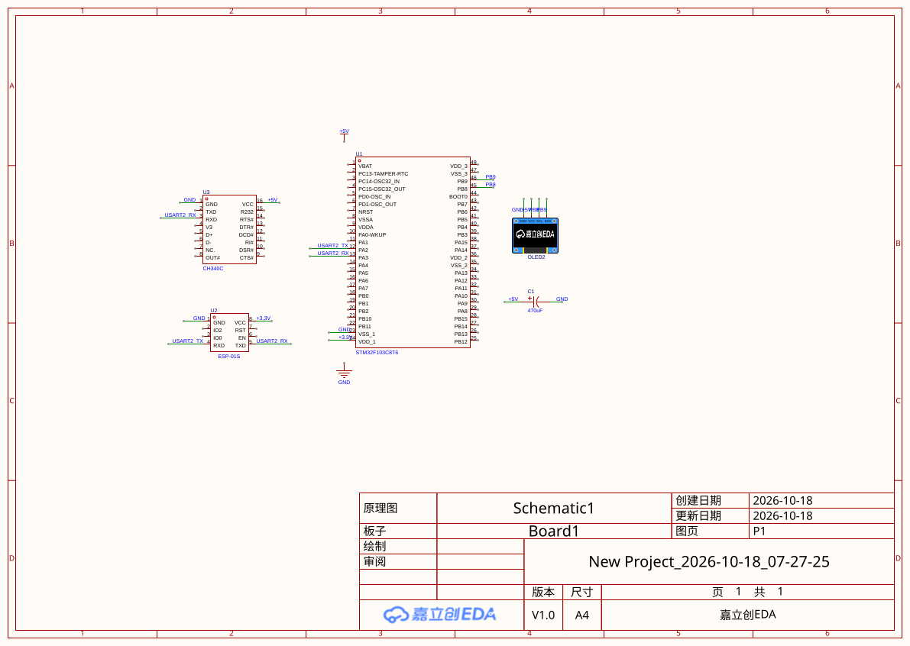

# stm32-esp8266-iot-gateway

STM32F103C8T6 + ESP8266（AT 指令）物联网上报网关 —— 江科大标准套件 · Linux 学习路线阶段 2。

STM32 采集传感器数据，通过 USART2 驱动 ESP8266（AT 指令）连上家庭 WiFi，将数据以 TCP 上报到 Linux 服务器（Ubuntu 虚拟机），打通"单片机 → WiFi → Linux 服务端"的完整链路。




## 系统架构

```
STM32F103 ──USART2──> ESP8266 ──WiFi──> 家庭路由器 ──> Windows 主机(:9999)
 （采集+AT驱动）      （透传）                              │ VMware NAT 端口转发
                                                     ▼
                                        Ubuntu VM · TCP Server :9999
```

- **固件侧（本仓库）**：USART2 + AT 指令驱动（发送 → 等关键字 → 超时 → 重试），自动完成连 WiFi、连 TCP、周期上报
- **服务端侧**：Linux TCP Server（另仓库），复用阶段 1 的帧解析状态机 + SQLite 落库

## 实现要点

- **AT 驱动设计**：`ESP_SendCmd(cmd, expect, timeout)` —— 发指令后每 1ms 查接收缓冲区（中断写入），`strstr` 匹配关键字，超时放弃；CIPSTART 失败自动重试 3 次
- **接收缓冲区**：USART2 接收中断逐字节写入环形字符缓冲区，随时保持 `'\0'` 结尾供 `strstr` 使用，写满防溢出
- **双串口调试**：USART1 留给日志（或 OLED 显示状态），USART2 专用于 ESP8266，互不干扰
- **健壮性细节**：AT 指令以 `\r\n` 结尾；CWMODE 兼容 `OK` / `no change` 两种固件回复；CWJAP 后延时 1 秒规避 `busy p...` 吞指令

## 硬件清单

| 器件 | 说明 |
|---|---|
| STM32F103C8T6 最小系统板 | 主控，PA2/PA3 = USART2 |
| ESP-01S + 转接板 | WiFi 模块；转接板板载 3.3V LDO 与电平转换 |
| CH340 USB 转 TTL | 给 ESP 供电（5V）+ 串口旁听调试 |
| 470µF 电解电容 | 并联在 ESP 供电旁，防发射瞬间掉电复位 |

接线细节见上方接线图。关键点：CH340 的 TXD 必须断开（STM32 的 PA2 接管 ESP 的 RX），只保留 RXD 旁听；所有 GND 共地。

## 编译与烧录

1. Keil MDK 打开 `Project.uvprojx`（STM32F10x 标准外设库 V3.5 已包含在仓库内）
2. 编译后通过 ST-Link 下载；勾选 Reset and Run 可自动运行
3. 首次运行观察 OLED：`INIT OK` 表示 WiFi 与 TCP 均连上；失败会显示 `dead step:n`（1=AT 2=CWMODE 3=CWJAP 4=CIPSTART）

## 已踩过的坑（详见《调试踩坑记录》）

- **ESP 固件在模式不变时回 `no change` 而不带 `OK`** —— AT 驱动需要兼容两种回复
- **CWJAP 之后立刻发下一条指令会被 `busy p...` 吞掉** —— 指令间需留间隔 + 重试
- **未初始化的外设读标志位永远为 0** —— 调试打印用的 USART1 没初始化，程序在打印处静默卡死
- **ESP8266 发射瞬间电流可达 300mA** —— 供电不足会表现为"一联网就复位"，电解电容是解药

## 路线图

- [x] 打通链路：STM32 + ESP8266 连上 Linux TCP Server
- [ ] 上行数据：接入 DHT11 / ADC，按自定义二进制帧协议上报
- [ ] 下行控制：服务端下发命令控制 LED / 风扇
- [ ] 断线重连：TCP 断链检测与自动重连
