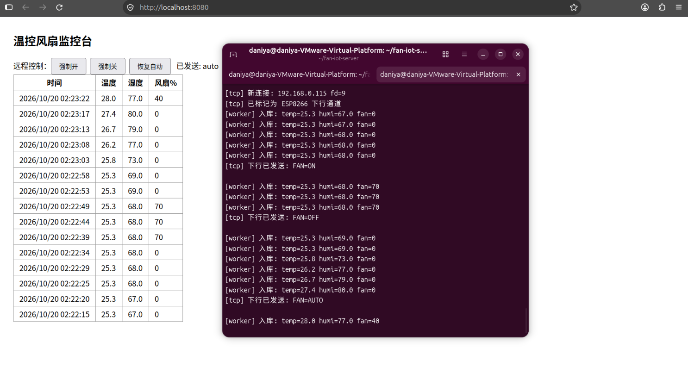
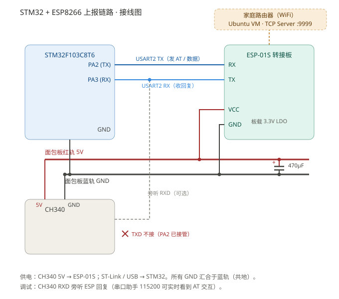
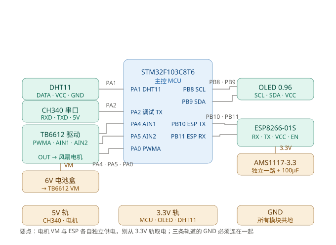
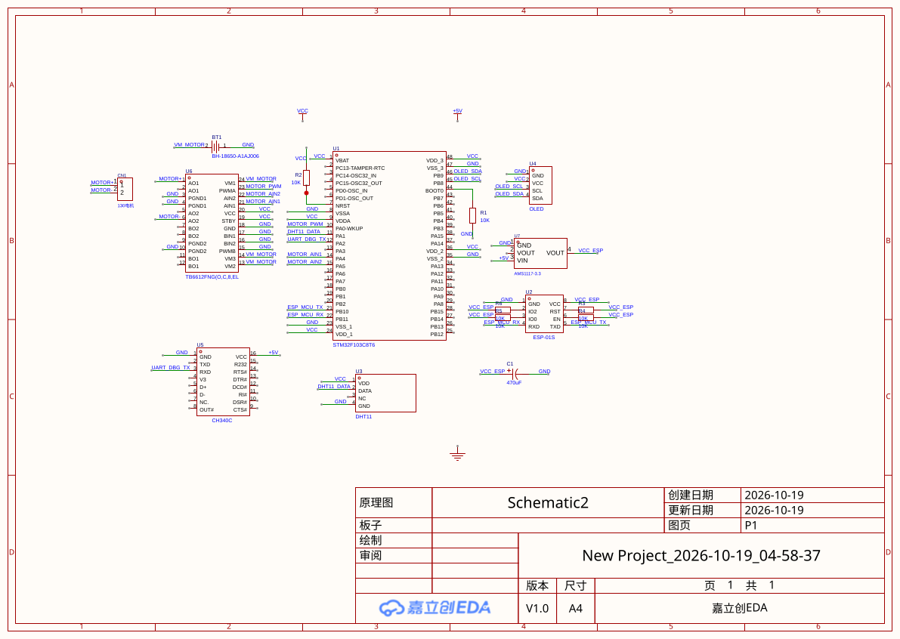
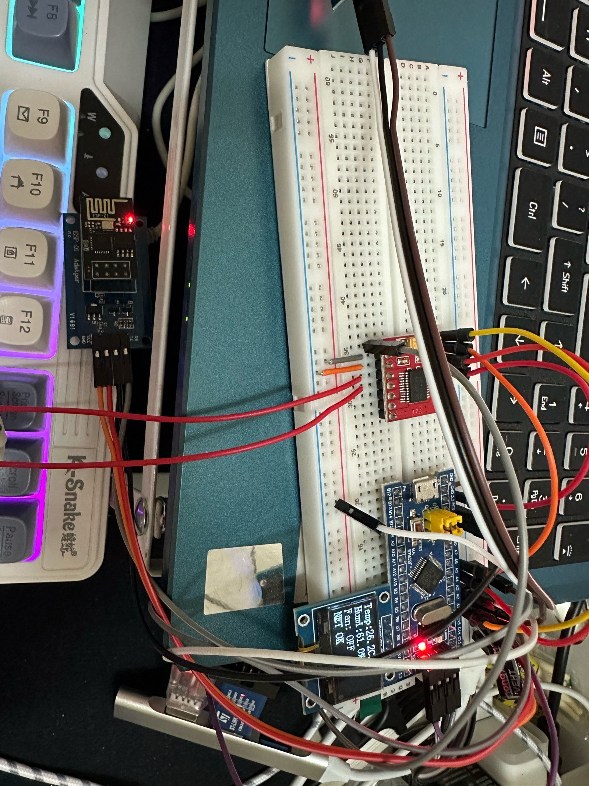

# 温控风扇 IoT 监控系统（STM32 + ESP8266 + Linux 服务端）

一个从零做的完整物联网项目：**设备端**用 STM32F103C8T6 采集温湿度、OLED 显示、按温度自动调风扇转速；**网络端**用 ESP8266 把数据每 4.5 秒上报 Linux 服务器；**服务器端**（本仓库 `server/` 目录）用纯 C 写了一个 epoll 高并发 TCP 服务，把数据存进 SQLite，并提供网页监控台——浏览器上既能看历史数据，也能点按钮远程遥控风扇。



> 上面这张图是系统最终运行状态：左边网页每 3 秒自动刷新温湿度历史（数据来自 SQLite），右边终端实时打印设备上报与命令下发。点"强制开"后表格里的风扇档位从 0 变 70——网页 → 服务器 → WiFi → 单片机 → 电机，整条链路真实打通。

---

## 目录

- [功能一览](#功能一览)
- [系统架构](#系统架构)
- [BOM 材料清单](#bom-材料清单)
- [引脚分配总表](#引脚分配总表)
- [开发历程：四个阶段](#开发历程四个阶段)
  - [阶段一：串口打通 ESP8266 联网上报](#阶段一串口打通-esp8266-联网上报)
  - [阶段二：DHT11 + OLED 本地监控](#阶段二dht11--oled-本地监控)
  - [阶段三：温控风扇（PWM + TB6612）](#阶段三温控风扇pwm--tb6612)
  - [阶段四：Linux 服务端](#阶段四linux-服务端)
- [问题与解决过程记录](#问题与解决过程记录)
- [使用说明书](#使用说明书)
- [原理图与实物](#原理图与实物)
- [目录结构](#目录结构)
- [后续计划](#后续计划)
- [术语白话对照表](#术语白话对照表)

---

## 功能一览

**设备端（STM32 固件）**

- DHT11 温湿度采集：单总线时序完全手写，含超时保护与校验和验证
- 0.96 寸 OLED 四行界面：温湿度 / 风扇档位 / 网络状态
- 温控自动调速：28°C 起 4 档 PWM（40% / 70% / 100%），20kHz 无啸叫；读数失败保持上一档
- 周期上报：每 4.5 秒发送 JSON `{"temp":26.7,"humi":77.0,"fan":40}`
- 远程控制：接收服务器下发的 `FAN=ON / FAN=OFF / FAN=AUTO`，强制开关风扇或交还自动模式
- 健壮性：WiFi/TCP 初始化失败不阻塞本地温控，AT 指令全部带超时与重试

**服务端（Linux C）**

- epoll 水平触发 TCP 服务器（端口 9999），支持多客户端
- TCP 粘包处理：按花括号配对从字节流中切出完整 JSON
- 生产者-消费者模型：网络线程收数据入队列，工作线程解析并写入 SQLite（WAL 模式）
- HTTP 服务（端口 8080）：`/api/history` 查历史、`/api/fan?set=on|off|auto` 下发命令
- 内置网页监控台：3 秒自动刷新表格 + 三个遥控按钮
- 优雅退出：Ctrl+C 走信号处理，线程按序关停、数据库正常关闭

---

## 系统架构

```
DHT11 ──> STM32F103C8T6 ──USART3──> ESP8266 ──WiFi──> 家里路由器
            │  ▲          (AT指令)                      │
          OLED  PWM(风扇)                    VMware NAT 端口转发
          PA0/PA4/PA5                    (vmnetnat.conf: 9999→虚拟机)
                                                       ▼
                                    Ubuntu 虚拟机 · fan-iot-server
                                       ├─ TCP :9999 收数据/发命令
                                       ├─ SQLite (fan.db) 历史数据
                                       └─ HTTP :8080 网页监控台
```

数据是"双车道"：上行遥测（设备→服务器）和下行控制（服务器→设备）走同一条 TCP 连接，互不干扰。

---

## BOM 材料清单

| 器件 | 数量 | 说明 | 参考价 |
|---|---|---|---|
| STM32F103C8T6 最小系统板（Blue Pill） | 1 | 主控，72MHz Cortex-M3，64K Flash | ¥15 |
| ESP-01S（ESP8266）+ 转接板 | 1 | 转接板板载 LDO 和电平转换，省去自己搭 3.3V | ¥10 |
| 0.96 寸 OLED（SSD1306，I2C 4 针） | 1 | 本地显示 | ¥12 |
| DHT11 温湿度传感器模块 | 1 | 单总线，±2°C 精度，够用 | ¥5 |
| TB6612FNG 电机驱动模块 | 1 | 双 H 桥，STBY 使能 + 双输入控方向 | ¥5 |
| 5V 直流风扇（带叶小电机） | 1 | 被控对象 | ¥5 |
| AMS1117-3.3 稳压模块 ×2 | 2 | 逻辑 3.3V 与 ESP 供电各独立一路 | ¥3 |
| CH340 USB 转 TTL | 1 | 烧录 + 调试日志查看 | ¥5 |
| ST-Link V2 | 1 | SWD 烧录 + 调试 | ¥15 |
| 面包板 + 杜邦线（公母各一束） | 若干 | | ¥15 |
| 5V USB 电源（手机充电器） | 2 | 主电源 1 个；电机独立供电 1 个（重要，见踩坑记录） | — |

合计约 ¥90（不含已有的开发板和烧录器）。

---

## 引脚分配总表

| 外设 | 引脚 | 用途 |
|---|---|---|
| DHT11 DATA | PA1 | 单总线温湿度 |
| TIM2_CH1 (PWM) | PA0 | 风扇调速，20kHz，占空比 0~100% |
| TB6612 AIN1 / AIN2 | PA4 / PA5 | 电机方向（两输入同高同低=刹车/滑行） |
| TB6612 PWMA | ← PA0 | 调速 |
| TB6612 STBY | 3.3V | 驱动使能（**不能悬空**，否则整个驱动不工作） |
| OLED SCL / SDA | PB8 / PB9 | 软件 I2C |
| USART2 TX | PA2 | 调试日志输出，115200 |
| USART3 TX/RX | PB10 / PB11 | ESP8266 AT 指令通道，115200 |
| USART1 | ~~PA9/PA10~~ | 调试中 PA9 损坏，已弃用（见踩坑） |

> 串口换位是本项目的一次重要教训：PA9 坏了以后，把"调试日志"和"ESP 通信"拆成两个串口（USART2 / USART3），互不抢占，后续调试再没互相干扰过。

---

## 开发历程：四个阶段

整个项目按下面顺序一步步长出来，每个阶段都是先让最小功能跑通，再加下一块。

### 阶段一：串口打通 ESP8266 联网上报

**目标清单**：让 ESP8266 连上 WiFi、连上 TCP 服务器、把数据发出去。

1. 先用 USB 转 TTL 模块 + 串口助手，单独调 ESP8266：发 `AT` 有回显，确认模块是好的
2. 写 `ESP8266.c`：`ESP_SendCmd()` 发指令 → 轮询接收缓冲区匹配关键字（`OK`/`WIFI GOT IP`/`CONNECT`）→ 超时返回错误
3. 初始化四步走：`AT` 握手 → `CWMODE=1` 设为 STA 模式 → `CWJAP` 连 WiFi → `CIPSTART` 建 TCP 连接，失败自动重试 3 次
4. 数据发送用两段式 `AT+CIPSEND=<长度>`：等 `>` 提示符再发数据本体
5. 下行方向：ESP 收到 TCP 数据会包成 `+IPD,长度:内容` 塞进串口，用 `strstr` 搜命令名即可，不必完整解析 +IPD 格式



**这一阶段最大的收获**：学会了"用已验证的引脚当锚点"排查硬件问题（详见[踩坑记录](#问题与解决过程记录)第 1 条），以及把调试串口和 ESP 通道拆成两个串口。

### 阶段二：DHT11 + OLED 本地监控

**目标清单**：本地能看到温湿度，不依赖网络。

1. 手写 DHT11 单总线时序：起始信号 → 传感器应答 → 40 位数据（湿度整数/小数 + 温度整数/小数 + 校验和）
2. 关键实现是"用循环次数测量高电平宽度来判 0/1"，阈值的选取踩了大坑（见踩坑第 2 条）
3. OLED 用江协科技的软件 I2C 驱动，自己排了四行界面：温湿度、风扇档位、网络状态
4. 加校验和验证：四个数据字节之和的低 8 位等于校验字节才算有效，读数失败显示 ERR 并保持上次风扇档位

### 阶段三：温控风扇（PWM + TB6612）

**目标清单**：风扇按温度自动分档，且能被远程强制开关。

1. 移植 PWM 驱动：TIM2 CH1 输出 20kHz PWM（原工程在 PA2，因为 PA2 让给了调试串口，迁移到 PA0）
2. 移植 TB6612 驱动：PA4/PA5 控方向，PWMA 接 PWM
3. 分档策略：`<28°C 关 / 28~30°C 40% / 30~32°C 70% / >32°C 100%`
4. 把三者捏合成主循环：读 DHT11 → 算档位 → OLED 显示 → 拼 JSON 上报 → 查下行命令
5. 下行命令状态机：收到 `FAN=ON` 进入手动模式固定 70%，收到 `FAN=AUTO` 交还自动分档

**这一阶段卡在最物理的地方**：电机只嗡嗡响不转。换驱动位置、调占空比都没用，最后确认是电源带不动——所有东西都从一路 5V 取电，ESP 发射瞬间 300mA、电机堵转电流更大，稳压模块直接被拉垮。**解药只有一个：大电流负载独立供电**。

### 阶段四：Linux 服务端

**目标清单**：做一个像样的 Linux C 服务端，把数据存下来、能在网页上看、能反控设备——同时把 Linux 应用层开发的知识点（epoll / 多线程 / 锁 / 数据库）全部用上。

1. **网络层 `tcp_server.c`**：epoll 水平触发主循环，监听 9999 端口；每个连接的接收数据放在独立缓冲区，按花括号配对切出完整 JSON 再回调上层——解决 TCP 粘包/半包；第一个连上来的客户端标记为 ESP 下行通道
2. **队列 `msg_queue.c`**：有界环形队列（64 条），互斥锁 + 条件变量；push 端（网络线程）队列满直接丢弃不阻塞，pop 端用 `while` 防虚假唤醒；退出时 `pthread_cond_broadcast` 唤醒消费者
3. **工作线程 `worker.c`**：从队列取 JSON → 手写解析器提取 temp/humi/fan → 写入 SQLite
4. **数据库 `db.c`**：WAL 模式让读写不互斥，busy_timeout 1 秒，INSERT 用预处理语句绑定参数
5. **HTTP 线程 `http.c`**：poll + 阻塞 accept 的简易 HTTP 服务，三个路由：`/` 内置网页、`/api/history?n=15` 返回最近 n 条 JSON、`/api/fan?set=on` 转发命令给 ESP
6. **优雅退出 `main.c`**：sigaction 捕获 SIGINT/SIGTERM，置标志让 epoll 循环退出，关队列、join 线程、关数据库

编译零警告（`-Wall -Wextra -O2`），最终运行效果见本文开头截图。

---

## 问题与解决过程记录

这些全是开发过程中真实踩过的坑，按遇到顺序记录。

### 1. 串口怎么都没有输出（PA9 物理损坏）

**现象**：程序逻辑确认无误，串口助手就是收不到数据；换回 PA10 收到的是乱码。
**排查过程**：先用"接 GND 就跳 00"验证 USB 转 TTL 链路是通的 → 换一个确认正常的程序在 PA2（USART2）上发心跳，能收到 → 说明程序没问题、链路没问题 → 反复验证 PA9 永远没输出 → 结论：**PA9 排针物理损坏**。
**解决**：调试串口迁移到 USART2（PA2），ESP 通道用 USART3（PB10/PB11），双串口分工。
**教训**：怀疑硬件时，用"已经验证过的好引脚"做锚点逐段排除，比反复改代码快得多。

### 2. DHT11 读出全 0，但校验和"假通过"

**现象**：读回来的 40 位全是 0，而校验和居然"通过"了（0+0+0+0 = 0 == 校验值 0）。
**排查过程**：逐位打印每个数据位的高电平循环计数，发现标称"1 位 = 70µs"实测只计到 25~35 次——软件循环每次迭代有 2~3µs 的额外开销，判位阈值 40 把真实的"1"全部误判成了"0"。
**解决**：阈值从 40 降到 15。
**教训**：① 软件延时的实际精度永远比标称差；② "校验和通过"不等于"数据正确"，全 0 的数据是能骗过异或校验的。

### 3. 电机只响不转

**现象**：PWM 拉满 100% 电机只嗡嗡叫，把驱动模块挪到靠近单片机的位置也没用。
**结论**：这是供电问题不是软件问题——所有负载共用一路 5V，电压被拉垮后电机得到的电流不足以启动。**物理问题没有软件解法**，独立电源是唯一解。
**教训**：面包板项目先算电流预算：ESP 发射瞬间 ~300mA、电机运行电流几百 mA，稳压模块标称 1A 是理想值。

### 4. ESP 初始化总是失败

**现象**：`CWJAP` 后紧跟的 `CIPSTART` 经常被 `busy p...` 吞掉。
**解决**：连接 WiFi 后延时 1 秒再发下一条，`CIPSTART` 失败自动重试 3 次；另外 `CWMODE` 的应答兼容 `OK` 和 `no change` 两种。
**教训**：AT 指令集的时序要求比文档写的更严格，"上一条指令刚回 OK"不等于"模块已就绪"。

### 5. 服务器一重启，设备就"失联"（隐性最深的坑）

**现象**：网页点按钮，服务器日志一直打 `[tcp] ESP 未连接，下行丢弃`，但 ESP 串口明明显示 `CIPSTART OK`。
**排查过程**：逐层排除——VM IP 没变 → netsh portproxy 规则是空的，实际转发走的是 VMware 自带的 `vmnetnat.conf` 端口转发 → 防火墙全关、端口监听正常 → 从 Windows 模拟 ESP 连接，服务器收到了！**整条网络链路是好的**。
**根因**：服务器重启会掐断 ESP 的 TCP 连接，而固件没有断线重连逻辑，ESP 抱着一条死连接继续发数据。
**解决**：重启服务器后按一下 STM32 复位键重新走 `ESP_Init`。
**教训**：排查网络问题要有"逐层验证"的意识——从内到外每一段单独测通断，而不是盯着最可疑的一处反复看。

### 6. 服务器收到第一条数据就段错误

**现象**：真 ESP 一连上（发数据），服务器立刻 `段错误（核心已转储）`；之前用 nc/浏览器测试都好好的。
**根因**：`main.c` 里 `tcp_server_run(NULL)` 把**空指针当回调**传给了网络层。之前的测试连接从没发过带 `{` 的数据，回调从没被调用过，直到真设备上报第一条 JSON 才引爆。
**解决**：补上 `on_esp_data` 回调，把 JSON 推入消息队列。
**教训**：测试数据覆盖不了"真实设备第一条消息"这种路径，上线前的自测要模拟真实数据形态。

### 7. 网页表格永远是空的

**现象**：终端明明在打印入库日志，网页表格一行数据都没有。
**根因**：`db_query_recent` 先往缓冲区写 JSON 前缀 `{"samples":[`，但"已用长度"从 0 起算，第一行数据从缓冲区第 0 字节开始追加，**把前缀整个覆盖了**，浏览器收到的是残缺 JSON，解析失败。
**解决**：已用长度记到前缀之后，数据从前缀末尾开始追加。
**教训**：往缓冲区追加内容时，偏移量必须和"已写入内容"严格对齐；这类 bug 用 `curl` 直接看 API 原始返回一眼就能定位。

---

## 使用说明书

按这份说明书可以从零复现整个作品。

### 第 1 步：硬件组装

1. 按上面[引脚分配总表](#引脚分配总表)在面包板上连线
2. DHT11 的 VCC 必须接 **3.3V**（接 5V 时序会漂）
3. TB6612 的 STBY 接 3.3V、PGND 与主 GND 共地；电机电源接独立的一路 5V
4. ESP8266 通过转接板接 3.3V 独立稳压（不要和逻辑部分抢同一路）

### 第 2 步：烧录固件

```bash
# 1. 准备私有配置（仓库不含真实 WiFi 密码）
cp User/config.h.example User/config.h
#    填入：WiFi 名称/密码、服务器 IP（服务器所在机器的局域网 IP）、端口 9999

# 2. 编译（二选一）
#    Keil：打开 Project.uvprojx 编译
#    VSCode + CMake：Ctrl+Shift+B → ② 构建

# 3. 烧录（OpenOCD + ST-Link）
openocd -f interface/stlink.cfg -f target/stm32f1x.cfg \
        -c "program build/firmware.elf verify" -c "reset run" -c "shutdown"
```

### 第 3 步：启动服务端

在 Linux 机器（物理机或虚拟机均可）上：

```bash
sudo apt install build-essential libsqlite3-dev
cd server
make
./fan-iot-server          # 默认 TCP 9999 / HTTP 8080 / 数据库 fan.db
```

看到 `=== fan-iot-server 启动 ===` 即成功。

> 如果服务器跑在 VMware NAT 虚拟机里，外部设备连不进来，需要在宿主机做端口转发：编辑 `C:\ProgramData\VMware\vmnetnat.conf` 的 `[incomingtcp]` 段加一行 `9999 = <虚拟机IP>:9999`，然后重启 VMware NAT 服务。

### 第 4 步：开始使用

1. 给设备上电，OLED 依次显示初始化 → 联网 → `NET OK`
2. 服务器终端出现 `[tcp] 新连接` 和 `[worker] 入库: temp=... `，说明上报通了
3. 浏览器打开 `http://<服务器IP>:8080`，进入监控台：
   - 表格每 3 秒自动刷新最近 15 条温湿度记录
   - **强制开**：手动模式，风扇固定 70%
   - **强制关**：手动模式，风扇关闭
   - **恢复自动**：交还温控逻辑（<28°C 关 / 28~30°C 40% / 30~32°C 70% / >32°C 100%）

### 日常使用注意

- **重启服务器后必须按一下 STM32 复位键**：固件目前没有断线重连，重启服务器会掐断 ESP 的 TCP 连接（见踩坑第 5 条）
- 用 Keil 开发调试时请关掉 VSCode 的 OpenOCD，两个工具会抢板子
- DHT11 显示 ERR 时优先检查 3.3V 排插接触

---

## 原理图与实物

### 1. 系统简易原理图（开发期手绘版）

先把模块间的连接关系画清楚，再进 EDA 画正式版：



### 2. 立创 EDA 正式原理图

在简易版基础上补全了 MCU 电源引脚（VDDA/VBAT/NRST/BOOT0）、ESP 的 EN/RST/IO0/IO2 上拉、第二路 AMS1117 稳压（ESP 独立供电）、TB6612 的 PGND 处理，并经过多轮自查修正（STBY 悬空、PGND 隔离、电机输出接错引脚等）：



PDF 版：[docs/schematic-lceda.pdf](docs/schematic-lceda.pdf)

### 3. 实物原型



### 4. 最终运行效果


---

## 目录结构

```
├── User/               主程序 main.c、中断服务、config.h.example（WiFi/IP 模板）
├── Hardware/           外设驱动：DHT11 / OLED / ESP8266 / Motor / PWM / Serial(调试) / Serial2(ESP)
├── System/             延时、定时器
├── Start/  Library/    启动文件 + 标准外设库 V3.5
├── cmake/  .vscode/    GCC 工具链配置 + VSCode 一键构建/烧录/调试
├── docs/               原理图（简易版/立创EDA版）、接线图、实物图、运行截图
└── server/             Linux 服务端（epoll + 生产者消费者 + SQLite + HTTP）
    ├── include/  src/  各模块头文件与实现
    ├── main.c          组装：启动各线程 + 信号处理
    └── Makefile        -Wall -Wextra -O2，链接 -lsqlite3 -pthread
```

---

## 后续计划

- [ ] 固件断线重连：上报连续失败 N 次自动重跑 ESP_Init
- [ ] 温度到 PWM 占空比的连续平滑映射（替代分档）
- [ ] 服务端守护进程化 + 温度历史曲线图
- [ ] 自定义二进制帧协议（带帧头/长度/校验，替换裸 JSON，练习完整协议设计）
- [ ] 迁移到真正的嵌入式 Linux 板卡（Orange Pi / 树莓派），服务端跑在设备本地

---

## 术语白话对照表

| 术语 | 白话解释 |
|---|---|
| 单总线 | 一根数据线传所有信息的通信方式，靠精确的信号长短区分 0 和 1 |
| AT 指令 | 用"AT 开头的文本命令"控制 ESP8266 这类模块的方式，发一句它答一句 |
| TCP 粘包 | 网络把多次发送的数据挤成一团送达，接收方要自己想办法切开 |
| epoll | Linux 上"同时盯着一大堆网络连接，谁有消息就叫醒我"的机制 |
| 水平触发 | 只要还有数据没读完，epoll 每次都会继续提醒你 |
| 生产者-消费者 | 一边往传送带放货、一边取货的模式，传送带满/空时双方互相等待 |
| 条件变量 | 让线程"没活时睡觉，来活时被叫醒"的工具 |
| 虚假唤醒 | 睡着的线程偶尔会无故醒来，所以醒来后必须再检查一遍条件 |
| WAL 模式 | SQLite 的一种工作模式：写的人写日志文件，读的人读旧数据，互不排队 |
| 预处理语句 | 把 SQL 模板先编译好，填参数就能反复执行，快且防注入 |
| 端口转发 | 让外面进来的连接"转个弯"送到内部另一台机器的对应端口 |
| 段错误 | 程序访问了不属于它的内存，被系统当场击毙 |
| 优雅退出 | 收到 Ctrl+C 不立刻暴毙，而是把手头的事收尾、资源归还再走 |
